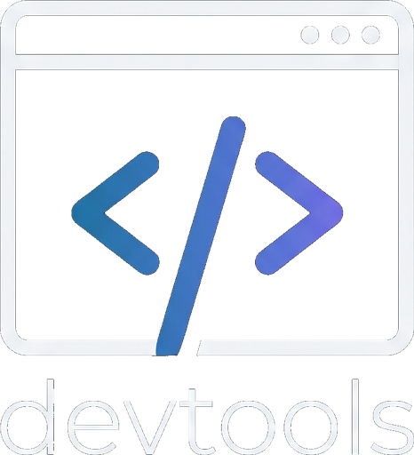

# Built-in Browser DevTools

<p align="center">
  
</p>

JetBrains IDE plugin that turns on **Chromium DevTools** for embedded **JCEF** views (built-in HTML preview, browser tool windows, etc.).

**Plugin ID:** `dev.nowtech.builtin.devtools`  
**Vendor:** [NOW Tech](https://phpstorm.nowtech.dev)

## Requirements

- PhpStorm / IntelliJ **2026.2+** (build `262.10968+`)
- Bundled **Web Browser (JCEF)** (`com.intellij.modules.jcef`)

## What it does

1. On startup (default **on**), sets registry  
   `ide.browser.jcef.contextMenu.devTools.enabled=true`  
   so **right-click → Open DevTools** appears on JCEF surfaces.
2. **F12** or **Tools → Open Built-in Browser DevTools** attaches via **Chrome DevTools Protocol** and opens the inspector in the **Built-in Browser DevTools** tool window (bottom, like Terminal) or in your system browser (Settings).

## Limitations

- Inspector UI uses CDP `devtoolsFrontendUrl` (hosted Chrome DevTools frontend) when available; local `127.0.0.1/devtools/…` is fallback.
- With this plugin disabled, the default IDE DevTools entry may not attach to all JCEF previews on 2026.x.
- **F12** may conflict with other plugins; rebind under **Settings → Keymap** if needed.
- Some JCEF views use off-screen rendering (OSR); if DevTools misbehave, try disabling OSR-related registry keys (see JetBrains docs).

## Build

```bash
cp gradle.properties.example gradle.properties
./builder build
```

**WSL tip:** first Gradle run can hang if the IDE platform cache is cold. Reuse another NOW Tech plugin cache:

```bash
rm -rf .intellijPlatform
cp -a ../phpstorm-protocol/.intellijPlatform .
./builder build
```

Do **not** use `bundledPlugin()` in Gradle for JCEF here — JCEF is compile-only from your local PhpStorm `plugins/jcef-plugin/lib`; runtime comes from `<depends>com.intellij.modules.jcef</depends>`.

## Install

**Settings → Plugins → Install Plugin from Disk…** → ZIP → restart IDE.

Re-open HTML preview / browser tabs after install so the context menu picks up the registry change.

## Verify

IDE log:

```text
Built-in DevTools: enabled registry key ide.browser.jcef.contextMenu.devTools.enabled
```

Logger: `dev.nowtech.builtin.devtools`

## License

MIT © [NOW Tech](https://phpstorm.nowtech.dev)
